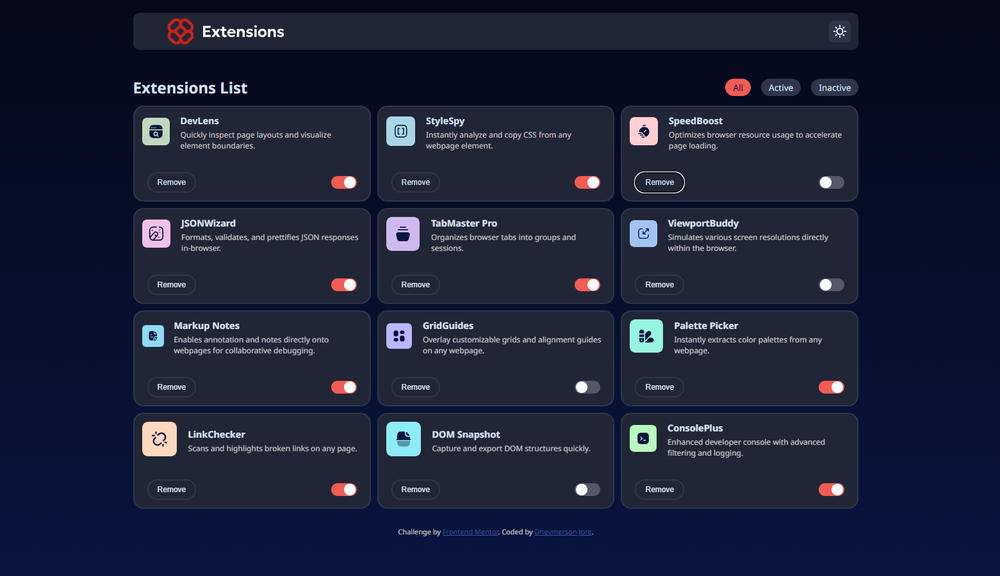
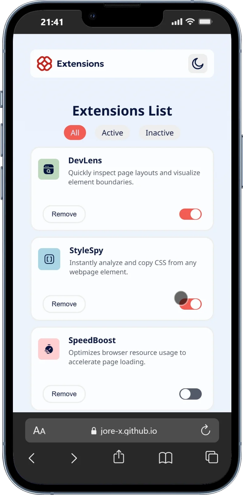

# Gerenciador de Extensões do Navegador

Projeto desenvolvido como solução para o desafio **Browser Extensions Manager UI**, da plataforma [Frontend Mentor](https://www.frontendmentor.io/).

O objetivo foi reproduzir uma interface responsiva para visualizar e gerenciar extensões, praticando conceitos de desenvolvimento front-end com HTML, CSS e JavaScript.

## Capturas de tela

### Versão desktop



### Versão mobile



## Demonstração

Acesse a versão publicada do projeto:

**[Visualizar projeto online](https://jore-x.github.io/browser-extensions-manager-ui-main/)**

## Funcionalidades

- **Filtragem de extensões:** visualização de todas as extensões ou filtragem por estado.
- **Ativação e desativação:** alteração do estado das extensões pela interface.
- **Remoção de extensões:** remoção de itens da lista.
- **Tema claro e escuro:** alternância entre os temas disponíveis.
- **Layout responsivo:** interface adaptada para diferentes tamanhos de tela.
- **Interatividade:** controles e elementos interativos para facilitar o uso da interface.

## Tecnologias utilizadas

- **HTML5:** estruturação do conteúdo.
- **CSS3:** estilização e adaptação para diferentes dispositivos.
- **JavaScript:** implementação das funcionalidades e interações.
- **JSON:** organização dos dados utilizados para exibir as extensões.

## Como executar localmente

Não é necessário instalar dependências para executar a versão estática do projeto.

1. Clone o repositório:

   ```bash
   git clone https://github.com/Jore-X/browser-extensions-manager-ui-main.git
   ```

2. Entre na pasta do projeto:

   ```bash
   cd browser-extensions-manager-ui-main
   ```

3. Abra o arquivo `index.html` no navegador.

   Se preferir, utilize a extensão Live Server no Visual Studio Code para executar o projeto em um servidor local.

## Objetivo do projeto

Este projeto foi desenvolvido com o propósito de praticar e aprimorar habilidades de desenvolvimento front-end por meio de um desafio prático, transformando um layout de referência em uma interface funcional e responsiva.

## Autor

**Jore-X**

- [GitHub](https://github.com/Jore-X)
- [Repositório deste projeto](https://github.com/Jore-X/browser-extensions-manager-ui-main)

## Créditos

Desafio proposto pela plataforma [Frontend Mentor](https://www.frontendmentor.io/).
